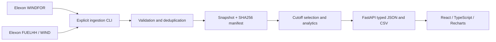

# Wind Intelligence

A React + Python product for replaying the wind forecasts available to a Great Britain electricity buyer before a day-ahead decision, and measuring their subsequent accuracy. An introductory homepage explains the pilot with locally packaged wind-energy imagery. The light analyst workspace includes decision replay, monthly accuracy, source provenance, alignment sensitivity, and CSV export.

The application uses real **Elexon WINDFOR and WIND FUELHH** data. No API key, database account, or AI inference service is needed. The included immutable snapshot lets the app start without contacting Elexon.

## Live application

**Vercel:** [https://plyrxy.vercel.app/](https://plyrxy.vercel.app/)

Open the [homepage](https://plyrxy.vercel.app/), [forecast dashboard](https://plyrxy.vercel.app/dashboard), or [interactive API documentation](https://plyrxy.vercel.app/docs). No local installation is needed to use the hosted application.

## Run with Docker

Start Docker Desktop, then from the repository root:

```sh
docker compose up --build
```

Open [the homepage](http://localhost:8000), [dashboard](http://localhost:8000/dashboard), and [API documentation](http://localhost:8000/docs). Stop with `docker compose down`.

The multistage image compiles React, installs pinned Python dependencies, packages the snapshot, and runs FastAPI as a nonroot user. `/readyz` verifies that a valid snapshot loaded; `/healthz` checks process health.

## Run locally

Requires Python 3.12 and Node.js 24. On Windows PowerShell:

Clone the repository and enter its root directory first:

```sh
git clone https://github.com/Abhinav1730/plyrxy.git
cd plyrxy
```

Then install dependencies, build the frontend, and start the server:

```powershell
python -m venv .venv
.\.venv\Scripts\python -m pip install -r backend/requirements-dev.txt
cd frontend
npm ci
npm run build
cd ..
.\.venv\Scripts\python -m uvicorn backend.app.main:app --host 127.0.0.1 --port 8000
```

On macOS/Linux, replace `.\.venv\Scripts\python` with `.venv/bin/python`.

Open [http://127.0.0.1:8000/](http://127.0.0.1:8000/) after the server starts. Stop the server with `Ctrl+C`. The bundled snapshot is loaded automatically; no data download or environment file is required.

For frontend hot reload, keep the API on port 8000 and run `npm run dev` from `frontend`. Vite proxies `/api` to FastAPI. For the production-style local preview use port 8000 after `npm run build`.

## What to inspect

- **Homepage:** read the pilot introduction, workflows, and data scope; enter the workspace or open accuracy/methodology directly.
- **Decision replay:** choose a January decision date and cutoff; inspect the next delivery day, forecast and actual series, signed errors, publication provenance, and exact CSV values.
- **Accuracy:** review MAE, RMSE, bias, WAPE, coverage, and daily results for all January decisions. Select a date in the breakdown to replay it.
- **Methodology:** understand cutoff rules, comparison limitations, source snapshot, and hourly-mean alignment sensitivity.

All actuals are retrospective. The application is a historical pilot, not a live trading or procurement execution platform.

## Important assumptions

1. **January means decision dates:** 1–31 January 2026, giving delivery dates 2 January–1 February. The brief is ambiguous; this implementation follows its wording about purchasing decisions.
2. **10:00 Europe/London is a configurable pilot cutoff**, not an official market deadline. Publications exactly at the cutoff are eligible. No later publication is used.
3. **Different native resolutions:** WINDFOR targets are hourly in the observed snapshot; FUELHH values are 30-minute average MW. Primary analytics join exact start timestamps. They therefore compare the forecast with the actual half-hour beginning at that timestamp, and do not claim equivalent averaging periods. Both actual half-hours are retained. The separate hourly-mean sensitivity calculation requires both halves. Neither method establishes the source forecast’s averaging semantics.
4. **Scope is the supplied GB datasets.** They do not describe the utility’s demand, contracted portfolio, prices, every renewable technology, or all UK generation. No actual procurement requirement, cost, or MWh total is inferred.
5. Historical publication time is the availability proxy. API receipt latency cannot be reconstructed. Historical actuals are the latest values found in the retrieved snapshot.
6. Accuracy is descriptive of this fixed cohort; no calibrated uncertainty band is claimed. Full-month metrics include days later than an individual replay decision.

## Design and data flow



Each target independently selects its latest publication with `publishTime <= cutoff`. A latest eligible null remains missing instead of reviving an older value. Exact duplicates collapse; conflicting same-key duplicates fail validation. Missing observations stay missing and lower coverage.

Signed error is **forecast − actual**. Positive means overforecasting. MAE is mean absolute error; RMSE is the square root of mean squared error; bias is mean signed error; WAPE is `100 × sum(abs(error)) / sum(actual)` over matched pairs. WAPE is null when its denominator is zero. Monthly statistics are computed from matched observations rather than averaged daily statistics.

The [architecture](docs/architecture.md), [methodology](docs/methodology.md), and [verification record](docs/verification.md) explain the implementation and competing hypotheses in more detail.

## Repository map

| Path | Responsibility |
|---|---|
| `README.md` | Setup, live application links, repository guide, API and deployment instructions |
| `backend/` | Python package containing the FastAPI application and backend tests |
| `backend/requirements.txt`, `requirements-dev.txt` | Pinned runtime dependencies and additional test/lint dependencies |
| `backend/app/models.py` | Source validation, indexing, typed report contracts |
| `backend/app/analytics.py` | Cutoff reconstruction, alignment, metrics |
| `backend/app/ingest.py` | Bounded source retrieval, retries, local raw cache, snapshot creation |
| `backend/app/repository.py` | Snapshot loading and integrity validation |
| `backend/app/main.py` | JSON/CSV endpoints, readiness, compiled frontend serving |
| `backend/app/audit.py` | Real-data cohort invariants and leaky-forecast comparator |
| `backend/tests/` | Unit, API, failure-path, and real-snapshot tests |
| `frontend/src/App.tsx` | Homepage/workspace entry with lazy-loaded dashboard |
| `frontend/index.html`, `frontend/src/main.tsx` | HTML shell and React application bootstrap |
| `frontend/package.json`, `package-lock.json` | Frontend commands, dependencies and reproducible npm dependency lock |
| `frontend/vite.config.ts`, `tsconfig.json` | Vite build/dev proxy, Vitest configuration and TypeScript compiler settings |
| `frontend/src/HomePage.tsx`, `home.css` | Product introduction, imagery, workflows and scope |
| `frontend/src/Dashboard.tsx` | Workspace navigation and decision filters |
| `frontend/src/Brand.tsx` | Shared brand/home navigation |
| `frontend/public/images/` | Optimized, locally served AI-generated wind imagery |
| `frontend/src/components.tsx` | Replay charts, snapshot panel, interval table |
| `frontend/src/views.tsx` | Accuracy and methodology views |
| `frontend/src/api.ts` | Abortable resource fetching and formatting |
| `frontend/src/api-schema.d.ts` | Generated types from backend OpenAPI |
| `frontend/src/styles.css` | Responsive light-mode design system |
| `frontend/src/*.test.tsx`, `test-setup.ts` | Frontend component/API tests and shared test setup |
| `data/snapshot.json.gz` | Versioned source-derived historical data used at startup |
| `data/manifest.json`, `data/README.md` | Snapshot checksum, retrieval metadata and data scope documentation |
| `docs/` | Architecture, methodology, implementation plan, verification |
| `docs/design-assets.md`, `docs/homepage.md`, `design-qa.md` | Image provenance, homepage design and visual QA notes |
| `docs/superpowers/plans/` | Implementation plan and acceptance criteria |
| `Dockerfile`, `compose.yaml` | Reproducible single-origin deployment |
| `Dockerfile.vercel` | Vercel container build packaging React, FastAPI and the snapshot |
| `vercel.json` | Single container service and public catch-all routing on Vercel |
| `pyproject.toml` | Pytest discovery and Ruff lint/format configuration |
| `.gitignore` | Excludes local environments, dependency/build output, caches and secrets |
| `.github/workflows/ci.yml` | Python, frontend, data audit, and container checks |

Generated local directories such as `.venv/`, `frontend/node_modules/`, `frontend/dist/`, and `data/raw/` are ignored by Git. They contain the Python environment, npm dependencies, compiled frontend, and optional ingestion cache respectively; they are not additional source files.

## Data refresh

```powershell
.\.venv\Scripts\python -m backend.app.ingest
.\.venv\Scripts\python -m backend.app.audit
```

The CLI downloads daily bounded queries with three workers and a three-day forecast-publication lookback. Raw responses are cached under ignored `data/raw/`; normalized output and retrieval metadata are packaged under `data/`. Rebuilding cached responses preserves their retrieval times separately from the build time. To refetch independently without touching an existing raw cache, use `--data-dir data-new`, inspect the new manifest and audit results, then replace the packaged snapshot deliberately. Restart the API after replacing a snapshot because reports are cached in memory.

Do not run ingestion automatically during API startup or page loads. A failed ingest does not substitute synthetic data. Snapshot and manifest replacements are individually atomic; a reader between replacements fails checksum validation rather than serving a mixed pair.

## Tests and formatting

```powershell
.\.venv\Scripts\python -m pytest -q
.\.venv\Scripts\python -m ruff check backend
.\.venv\Scripts\python -m ruff format --check backend
.\.venv\Scripts\python -m backend.app.audit
cd frontend
npm test
npm run build
npm run format:check
npm audit --audit-level=moderate
```

Regenerate frontend API types while the backend is running with `npm run typegen` from `frontend`.

## API

| Route | Parameters |
|---|---|
| `GET /api/v1/meta` | Snapshot and cohort metadata |
| `GET /api/v1/day` | `decision_date=2026-01-14&cutoff=10:00` |
| `GET /api/v1/accuracy` | `cutoff=10:00` for the January decision cohort |
| `GET /api/v1/export` | Same decision-date/cutoff parameters; CSV with provenance |
| `GET /healthz`, `GET /readyz` | Health and snapshot readiness |

Dates outside January and invalid cutoffs receive 422 responses. A missing or corrupt snapshot returns 503 from readiness and analytics, while process health remains available.

## Hosting

The application is deployed on **Vercel** at [https://plyrxy.vercel.app/](https://plyrxy.vercel.app/).

Import the GitHub repository with the repository root (`./`) as the Root Directory and `main` as the Production Branch. The root `vercel.json` declares one public container service named `app`, built from `Dockerfile.vercel`. Set `PORT=8000` in Vercel's project environment variables. The Dockerfile handles dependency installation and frontend compilation; no separate frontend/backend services, internal bindings, database, or API keys are required. All public paths, including `/api/v1/...`, reach the same FastAPI server, which also serves the compiled React application.

With Vercel's Git integration connected, pushes to `main` trigger production deployments. After deployment, check `/`, `/dashboard`, `/docs`, and `/readyz`, and verify charts and CSV export. The snapshot ships inside the image; rebuild and redeploy to publish a refreshed snapshot.

### Alternative: Heroku

The application is prepared for a single Heroku web container, which binds to the platform-provided `PORT`. Using an authenticated Heroku CLI and an app in your account:

```sh
heroku create YOUR_ANONYMOUS_APP_NAME --stack container
heroku container:login
heroku container:push web --app YOUR_ANONYMOUS_APP_NAME
heroku container:release web --app YOUR_ANONYMOUS_APP_NAME
heroku open --app YOUR_ANONYMOUS_APP_NAME
```

The Heroku commands are an alternative deployment path; the live application linked above is hosted on Vercel. No persistent filesystem is required.

See [Heroku’s container runtime documentation](https://devcenter.heroku.com/articles/container-registry-and-runtime). Deployment credentials belong in the hosting/CI secret store, never in the frontend or Git repository.

## Source and AI disclosure

Contains BMRS data © Elexon Limited copyright and database right. Source: [Elexon Insights](https://developer.data.elexon.co.uk/), [WINDFOR](https://bmrs.elexon.co.uk/api-documentation/endpoint/datasets/WINDFOR/stream), [FUELHH](https://bmrs.elexon.co.uk/api-documentation/endpoint/datasets/FUELHH/stream). Source documentation: [OpenAPI specification](https://data.elexon.co.uk/swagger/v1/swagger.json). Data reuse is subject to Elexon’s applicable [BMRS data licence](https://www.elexon.co.uk/bsc/data/balancing-mechanism-reporting-agent/copyright-licence-bmrs-data/).

AI assistance: OpenAI Codex assisted with architecture, implementation, tests, documentation, and review. OpenAI image generation produced the selected visual concept and two illustrative homepage images. Asset prompts and provenance are in [design assets](docs/design-assets.md). The product does not call an AI service at runtime; displayed analytical values come from Elexon data and deterministic calculations.
