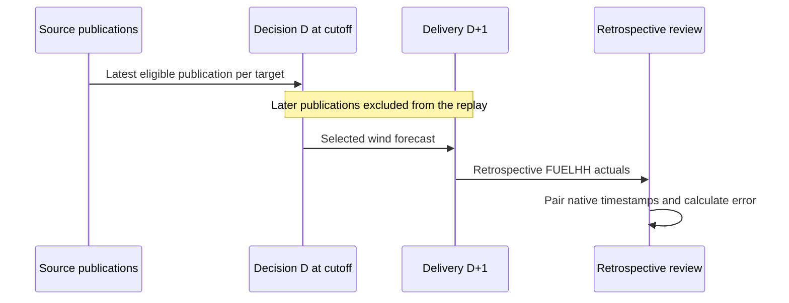

# Analytical methodology

## Scope and time

The cohort is January **decision dates**. Each decision D evaluates delivery D+1. The grid is constructed from timezone-aware London midnight boundaries, then compared in UTC. January 2026 has 24 hourly forecast targets and 48 half-hour actuals per delivery day: 744 and 1,488 respectively. Supporting other months, including DST transitions, requires extending explicit cohort validation and reviewing resolution semantics; this application does not silently accept those dates.

Decision cutoff defaults to 10:00 Europe/London. It is not an asserted market rule. `publishTime <= cutoff` is inclusive. Publication time proxies source availability, not historical API arrival time. Forecast lead time and availability age are distinct: the snapshot panel shows age before cutoff, not time until delivery.

## Alignment policy and competing interpretations

Official API documentation describes FUELHH as average MW over 30 minutes. WINDFOR supplies target and publication timestamps without an explicit averaging-period field in its row schema. The sampled and packaged January records have hourly targets. Legacy glossary descriptions of publication cadence do not match every observed publication; the implementation follows actual `publishTime` values rather than hardcoding a schedule.

Primary policy: join exact start timestamps. A 12:00 forecast is paired with the actual for 12:00–12:30. This avoids invented forecasts and preserves source values, but does **not** establish equivalent averaging periods. It is explicitly a timestamp-matched diagnostic.

Sensitivity policy: compare the same forecast against the mean of 12:00–12:30 and 12:30–13:00 actuals, requiring both. This tests an hourly-average interpretation without asserting it is authoritative. Linear interpolation or forward filling forecasts into 48 targets was rejected for the primary product because it invents half-hour forecast values. No energy total is calculated from the diagnostic comparison.

All actual half-hours remain in the packaged snapshot and contribute to completeness and the sensitivity check. Primary coverage has a 24-target daily denominator, not a 48-target denominator. Completeness of actual source data and coverage of matched comparisons are separate concepts.

## Validation and revisions

- Reject naive timestamps and nonfinite/negative MW.
- Preserve null generation as unavailable.
- Deduplicate exact `(target, publication, fuel)` records. Reject conflicting values at the same key.
- Select latest eligible forecast per target, including nulls, so superseded values are never revived.
- Select latest retrieved WIND actual per target; this is explicitly retrospective.
- Preserve an expected grid even when an entire day is missing.
- Exclude missing pairs from errors, keep gaps in charts, and show coverage.
- Flag forecast publications older than 24 hours at cutoff.
- Verify snapshot SHA256 and source-record counts at startup.

The immutable snapshot and query manifest make a result reproducible. Raw caches are a developer convenience; see known ingestion robustness limitations in the verification record.

## Metrics

For paired forecast F and actual A, error E = F − A. Positive error means overforecasting. Exact hits belong to neither overforecast nor underforecast counts.

| Metric | Formula |
|---|---|
| MAE, MW | mean(abs(E)) |
| RMSE, MW | sqrt(mean(E²)) |
| Bias, MW | mean(E) |
| WAPE, % | 100 × sum(abs(E)) / sum(A), only matched pairs |
| Coverage, % | 100 × matched / expected targets |

Undefined metrics are null, never NaN or fabricated zero. Forecast average summarizes every available selected forecast independently of actual coverage. Monthly metrics aggregate all matched pairs, not averages of daily RMSE or WAPE.

Historical error is not a predictive confidence interval. No utility demand, prices, contracted capacity or other generation is available, so actual procurement volumes and costs cannot be calculated. Elexon’s GB datasets do not imply complete UK wind or renewable coverage.
